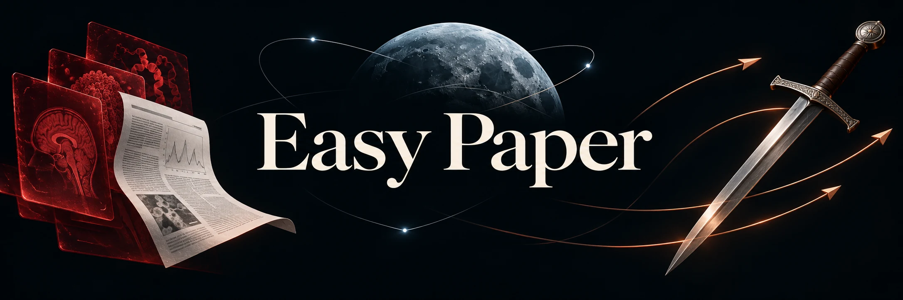

# Easy Paper



Turn any Applied Linguistics, SLA, TEFL or L2 acquisition paper (MA/PhD level) into study PDFs built for a reader with ADHD, or for anyone who wants notes that are friendlier, more structured and faster to use: gold nuggets first, Hunt-Question chunks, a visual in every chunk, Preview Questions at the start, and a Wrap-Up Quiz at the end.

By Sajjad Irani (Teacher SAM). Version 1.6.1.

## Install the Easy Paper marketplace

**ChatGPT workspaces.** A workspace admin can open **Admin Console → Plugins → Add → Import marketplace** and enter `https://github.com/teachersam7734-web/easy-paper` as the source. Leave **Path** empty. Choose `main` for updates or `v1.6.1` to pin this release. After import, set Easy Paper to **Available** or **Installed** for the intended members. [ChatGPT marketplace import guide](https://help.openai.com/en/articles/20001504-importing-and-syncing-plugin-marketplaces-from-github)

**ChatGPT desktop and Codex.** Register the catalog, then select **Easy Paper** as the source in the desktop Plugins Directory and install the plugin.

```sh
codex plugin marketplace add teachersam7734-web/easy-paper
```

**Claude Code.** Add the public GitHub marketplace and install its Easy Paper entry.

```sh
claude plugin marketplace add teachersam7734-web/easy-paper
claude plugin install easy-paper@easy-paper-marketplace
```

**Claude chat and Cowork.** Open **Customize → Plugins → Add → Add marketplace → Add from a repository**. Enter `teachersam7734-web/easy-paper`, then install the Easy Paper entry. You can also upload the [Easy Paper plugin ZIP](https://github.com/teachersam7734-web/easy-paper/releases/latest/download/easy-paper.zip). [Claude plugin guide](https://support.claude.com/en/articles/13837440-use-plugins-in-claude)

**Claude organization marketplaces.** Team and Enterprise owners can upload the ZIP to a marketplace in **Organization settings → Plugins & skills**. Organization-wide GitHub sync requires a private or internal marketplace repository. [Claude organization marketplace guide](https://support.claude.com/en/articles/13837433-manage-plugins-for-your-organization)

## Download and try

Download the full plugin, an individual skill, or one of the three offline HTML presentations from [GitHub Releases](https://github.com/teachersam7734-web/easy-paper/releases/latest). After downloading an HTML file, open it directly in a browser.

| Agiel | Confessor | Seeker |
|---|---|---|
|  |  |  |
| AI detection and second-language writing | How mixed methods research is defined | AI across the academic publishing process |

Each example includes six study views, a captioned film, and a Wrap-Up Quiz with two-sided flashcards. Toggle motion from the hero or use your system's reduced-motion setting. See the [artwork prompts](docs/artwork/imagegen-prompts.md) and the [film credits](skills/easy-paper-mordsith/references/paper-films.md).

Download the [12 original study handouts](examples/handouts/README.md), with a Deep Dive, Critique, Review Guide, and Vocab Treasure for each paper.

## Modes and companions

In ChatGPT and Codex, choose an Easy Paper skill in the picker or name the workflow in your prompt. The commands below are for the installed Claude Code plugin.

| Skill | Claude Code command | When | Output |
|---|---|---|---|
| **Deep Dive** | `/easy-paper:deep-dive <paper>` | You must present the paper; high stakes; there is time | 5 to 10 pages (at most half the paper): plain-language explanation, roadmap, gaps and newer research, presenter kit, glossary, quiz |
| **Critique** | `/easy-paper:critique <paper>` | Oral exam, seminar, viva | 3 to 5 pages: verdict and ratings, summary beats, strength and weakness cards with proof, fixes and say-it lines, a 90-second script, examiner Q&A, quiz |
| **Review Guide** | `/easy-paper:review-guide <paper>` | Exam in about 2 hours, paper not read | Exactly 4 pages: mind map, 80/20 ranked must-knows, memory hooks, likely exam questions, 2-hour game plan, quiz |
| **Vocab Treasure** | `/easy-paper:vocab-treasure <paper>` | Build your bank of academic language | 1 to 2 cinematic pages (about 1 per 10 pages of article): C1-C2 items with verbatim context, alternatives, examples; feeds the cumulative Treasure Chest; footer only, so the pages can be bound into a booklet |
| **ADHD Student** | `/easy-paper:study`, `/easy-paper:memory-link`, `/easy-paper:adhd-qc` | Study with an AI buddy; remember lists and heavy definitions; check any output for ADHD-friendliness | Guided sessions (Prompt Vault, about 100 prompts), Memory Links, ADHD QC reports and fixes |
| **Mord’Sith** | `/easy-paper:mordsith` | Present or study an ADHD-QC-passed set of four outputs | One cinematic offline presentation with interactive study modes, an optional captioned paper film, and original handouts |
| *(router)* | `/easy-paper:easy-paper <paper> [mode or all]` | Not sure which, or all four | Asks once, or follows the master prompt |
| *(QC and upkeep)* | `/easy-paper:ep-qc`, `/easy-paper:ep-improve` | Inspect an output or the plugin; improve the plugin | Scored fix list; The Improver (Opus, high effort) upgrades and logs to IMPROVEMENTS.md |

**Master prompt:** `skills/easy-paper-core/references/master-prompt.md`. Pick the modes, ADHD QC on or off, Memory Links, an interactive application (Mord'Sith themes Agiel, Confessor, Seeker) and a study-buddy session in one paste.

## Personas (one unified agent, many personalities)

| Agent | Persona | Job |
|---|---|---|
| `ep-analyst` | The Analyst | Reads the paper and builds the shared dossier; about 80% of a Deep Dive |
| `ep-scout` | The Scout | Newer research and gaps, all verified |
| `ep-judge` | The Judge | CC Specialist critique: yardstick, fairness filter, FAE and CECA |
| `ep-coach` | The Coach | Say-it lines, scripts, examiner Q&A |
| `ep-distiller` | The Distiller | 80/20 exam-weight ranking, mind map, hooks |
| `ep-lexicographer` | The Lexicographer | Picky C1-C2 language mining for Vocab Treasure |
| `ep-quizmaster` | The Quizmaster | Preview Questions and Wrap-Up Quizzes |
| `ep-memory-linker` | The Memory Linker | Mnemonics, codes, stories, tangible definitions, prior-knowledge links |
| `ep-designer` | The Designer | Builds the spec, renders, fixes layout |
| `ep-layout` | The Layout Doctor | Overlap, trespass, overflow, empty space, orphans: clean pages |
| `ep-inspector` | The Inspector | Facts, quotes, pages, fairness |
| `ep-adhd-auditor` | The ADHD Auditor | ADHD QC scoring and fixes |
| `ep-distracted-reader` | The Distracted Reader | Simulated skim and retrieval-cue review |
| `ep-improver` | The Improver (Opus, high effort) | Examines and improves the whole plugin |

Without subagents (web chat), the same pipelines run as a relay: one agent switches persona stage by stage and writes each stage to a file. Use the standalone `.skill` files from `tools/build_dist.py` there.

## Quality gates
1. `validate.py` (also the PostToolUse hook) enforces every count and writing rule from one `LIMITS` table.
2. `render.py` checks the page budget and sheet overflow, then runs `layout_check.py`: overlap, trespass into margins and footer, underfill and empty space, blank bands, orphaned headings, tiny text.
3. `check_quotes.py` verifies every verbatim quote and Vocab Treasure context against the paper, with its page.
4. The Inspector fact-checks; the optional ADHD QC (Auditor plus Distracted Reader) checks learning design.

## Structure
```
easy-paper/
  .claude-plugin/plugin.json
  commands/   easy-paper, deep-dive, critique, review-guide, vocab-treasure, mordsith, study, memory-link, adhd-qc, ep-qc, ep-improve
  agents/     14 persona agents
  hooks/      claude.json + lint_spec.py
  skills/
    easy-paper-core/  router SKILL.md; references (ADHD design, gold-nugget method, dossier, genres, personas, field map,
                      AL glossary, quiz design, writing rules, spec schema, QC rubric, page layout, master prompt,
                      field/ with 10 figures + 10 landmark papers); scripts (extract, render, validate, layout_check,
                      check_quotes, vocab_bank); assets (fonts, css, js, icons)
    deep-dive/ critique/ review-guide/ vocab-treasure/   each: SKILL.md, references (pipeline, layout template, glossary, ...), assets (theme, skeleton)
    adhd-student/     SKILL.md; prompt-vault/ (9 files + index); references/science, memory-link, sources; adhd-qc-rubric.md
    easy-paper-mordsith/  skill, builder, theme sources, content JSON and finished offline templates
  tools/build_dist.py
```

## Open the plugin and templates

From the cloned repository root, start Claude Code with `claude --plugin-dir .`. The Mord’Sith command is `/easy-paper:mordsith`. The plugin ZIP contains the Easy Paper source directory and marketplace manifests. The six standalone `.skill` archives include their own entry points and files.

Open any of [Agiel](skills/easy-paper-mordsith/templates/Agiel.html), [Confessor](skills/easy-paper-mordsith/templates/Confessor.html), and [Seeker](skills/easy-paper-mordsith/templates/Seeker.html) in a browser. The [Mord’Sith build guide](skills/easy-paper-mordsith/references/build-and-review.md) shows how to reuse each template for another paper.

## Requirements
Expose Python 3 as `python` on your PATH. An activated virtual environment provides that command. PDF export uses `playwright` (Chromium) and `pdfplumber`. Install the Python packages with `python -m pip install playwright pypdf pdfplumber` and set up Chromium with `python -m playwright install chromium`. PDF text extraction uses Poppler's `pdfinfo` and `pdftotext` when available and falls back to `pypdf`. The Inspector can use Poppler's `pdftoppm` for visual layout review.

Mord’Sith builds with standard-library Python 3.9 or later. Its HTML files can be opened offline in a modern browser.

## Design
Light, print-friendly paper with Teacher SAM gold and cyan neon accents, plus a cinematic "Midnight Reel" theme for Vocab Treasure. Fonts (SIL OFL, embedded in every PDF): Sora, Space Grotesk, Outfit, Inter, JetBrains Mono, EB Garamond, Syncopate, Michroma, Exo 2, Allura. Icons: Lucide (ISC).
